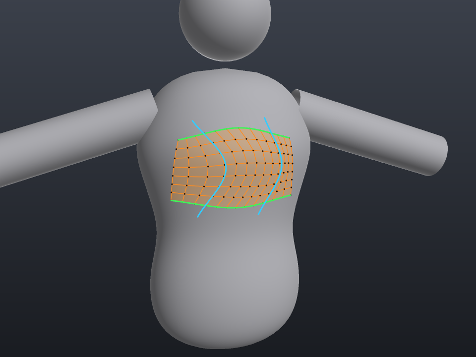
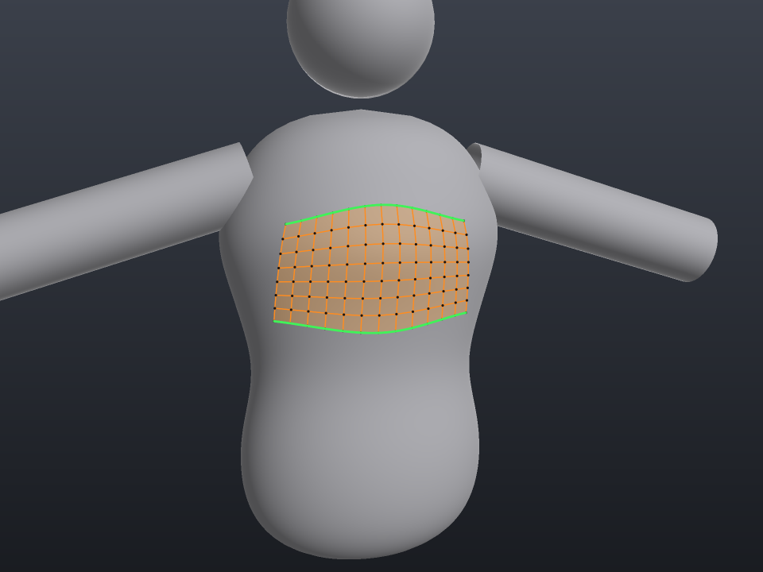
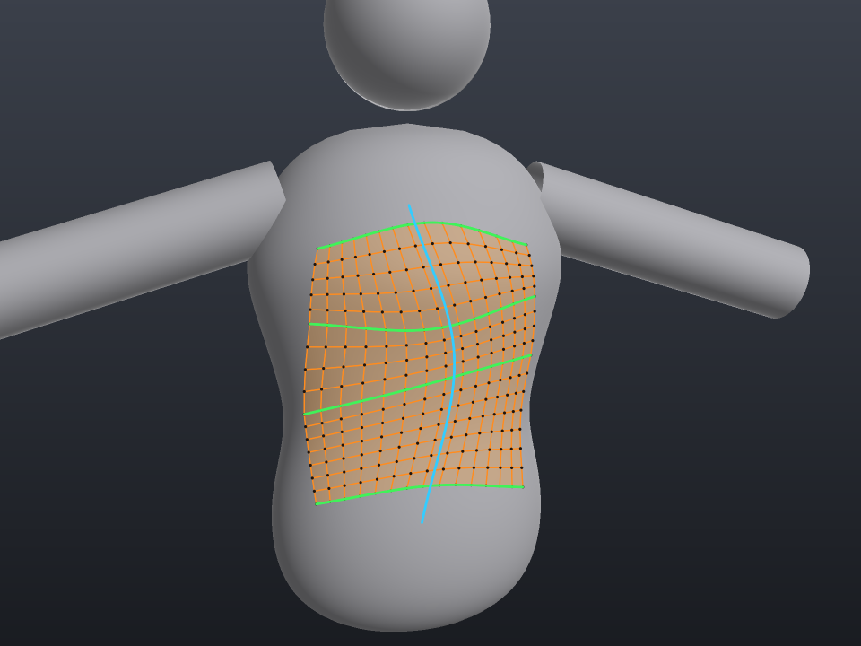
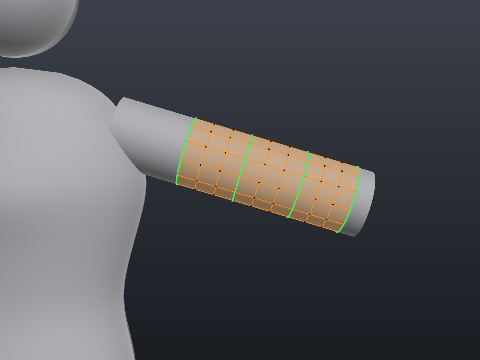
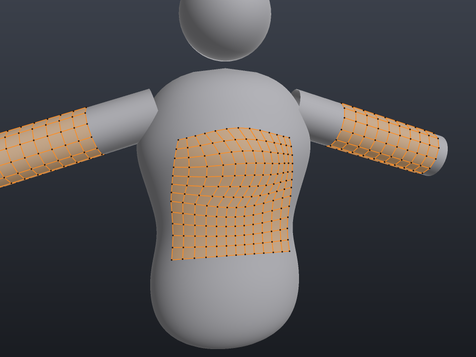

# TopoWeave: spline-driven retopology for 3ds Max

<p align="center"></p>

**TopoWeave** is a retopology modifier for 3ds Max. You draw splines directly
on a high-poly character. Between every two splines TopoWeave builds a
**bridge of quads that is conformed to the body's surface**, and every extra
spline you draw gives you more control over the shape and flow of that band.

---

## بالعربي

**TopoWeave** موديفاير ريتوبولوجي لـ 3ds Max. بترسم سبلاينز على الموديل الهاي بولي، والأداة بتعمل **جسر بوليجونز (Quads) بين كل سبلاينين، ملزوق (Conformed) على جسم الشخصية**.
وكل ما ترسم خطوط أكتر، الجسر يبقى مظبوط على مقاسك أكتر:

| النوع | بيترسم إزاي | بيعمل إيه |
|---|---|---|
| **Guide** (أخضر) | LMB على طول الجسم | بيحدد حواف الجسر. ٣ Guides أو أكتر بيخلوا الـ Flow ينحني بنعومة بينهم |
| **Rail** (سماوي) | خط بيقطع الـ Guides (أو Shift) | بيتحكم في اتجاه الأعمدة جوه الجسر. كل Rail زيادة = تحكم أكتر |
| **Contour** | Alt + سحب بالعرض على دراع أو رجل | بيعمل حلقة كاملة حوالين العضو، حتى الجزء اللي ورا ومش باين |
| **Border** | Ctrl+Shift على حافة مفتوحة | بيكمّل من توبولوجي موجودة أو بيعمل Bridge بين حافتين |

- **دبل كليك / Enter / كليك يمين** = Commit. بعد الـ Commit الأداة بتكمّل تلقائيًا من آخر صف.
- كل حاجة بتدعم **Undo** الطبيعي بتاع ماكس (Ctrl+Z): الخطوط، الـ Commit، والفُرش.
- فيه فُرش **Relax / Move / Conform**، وعرض **Cage** تحت TurboSmooth، و**Topology Inspector**، و**Snap للمحور 0** عشان الـ Symmetry.

> **حالة المشروع:** المحرك الهندسي (core) متختبر بالكامل: 32 تست و389 Check، وفيه Demo بيرسم الصور اللي تحت.
> طبقة 3ds Max مكتوبة على الـ SDK الرسمي ومتأكد إنها بتتعمل لها Compile ضد Stand-in للـ API، **لكن لسه ما اتبنتش ولا اتجربت جوه 3ds Max حقيقي**.
> ابنيها على Windows بالخطوات اللي في [`docs/BUILD_WINDOWS.md`](docs/BUILD_WINDOWS.md)، وأي Error يظهر ابعتهولي وأنا أصلّحه.

---

## How the Spline Bridge works

| Two guides | Rails customise the flow |
|---|---|
|  |  |
| **More guides: more control over the shape** | **Contour rings wrap whole limbs** |
|  |  |

1. **Guides** run along the band, like edge loops. Two guides make a band.
   More guides bend the band smoothly through all of them (centripetal
   Catmull-Rom across the guides). A guide drawn *between* two others is
   inserted in the right place automatically.
2. **Rails** run across the guides. A rail decides *which point of one guide
   flows into which point of the next*, and gives the interior its exact
   shape. Several rails are blended smoothly. Draw rails on the open ends to
   set the side boundaries exactly (a Coons/Gordon-style patch).
3. **Contours**: Alt-drag across an arm, leg or finger. The surface is sliced
   with the plane under your stroke, and you get a complete ring around the
   limb, including the hidden back side.
4. **Borders**: Ctrl+Shift-drag along an open border to continue existing
   topology with welded, shared vertices. Load two borders to bridge them.
5. The interpolated grid is projected onto the High Poly along its own normal
   (stable in folds and armpits), lifted by **Offset**, spaced evenly along
   every column, and lightly relaxed. Faces always point outwards.

After a commit, the last row becomes a border guide, so the next stroke
simply continues the band:

<p align="center"></p>

## Viewport gestures

| Spline Bridge (`1`) | |
|---|---|
| LMB drag | Draw a guide. A stroke that crosses two guides becomes a rail |
| Shift + LMB drag | Draw a rail |
| Alt + LMB drag | Contour ring across a limb |
| Ctrl + LMB drag | Segments along the guides |
| Ctrl + Alt + LMB drag | Rows per span |
| Shift + Alt + LMB drag | Twist the last ring |
| Ctrl + Shift + LMB | Use an open border (drag = span, click = whole loop) |
| Ctrl + Shift + Alt + LMB | Delete the stroke under the cursor |
| Double click / Enter / RMB | Commit |
| Ctrl + Z | Undo the last stroke, adjustment or commit |

| Brushes (`2` Relax, `3` Move, `4` Conform) | |
|---|---|
| LMB drag | Apply the brush (projected onto the High Poly) |
| Ctrl + Alt + LMB drag | Strength |
| Ctrl + Shift + Alt + LMB drag | Radius |

Hotkeys are active only while TopoWeave is the selected modifier. You can
remap them in *Customize > Hotkey Editor > TopoWeave*.

## Features

- Projected topology on one or many High Poly sources, with a configurable **Offset**
- Spline Bridge with guides, rails, contours and border continuation or bridging
- **Native Undo/Redo** for every operation, including individual strokes
- Floating palette that belongs to the active TopoWeave modifier
- Live preview grid, colour-coded strokes and cursor hints
- Relax / Move / Conform brushes; Conform All / Relax All
- Operation-scoped **Auto Weld** (only new or moved vertices weld)
- **Show Cage** for working under TurboSmooth with *Show End Result*
- **Topology Inspector** and **Repair** (degenerate faces, isolated vertices)
- **Snap to world X/Y/Z = 0** for symmetry seams (respects transforms, no Reset XForm)
- Topology is saved in the .max file; the modifier output is a regular PolyObject

## Repository layout

```
core/            SDK-independent geometry engine (C++17, no dependencies)
  include/rtp/   Surface (BVH), Polyline, MonotoneMap, PolyMesh, MeshOps, Stroke, Bridge
max/             3ds Max plug-in (modifier, tools, palette, hotkeys, resources)
  devtools/      SDK stand-in + script to syntax-check the Max layer without the SDK
tests/           Unit tests for the core (run on Linux, macOS and Windows)
tools/demo/      Offline demo: simulated strokes on a character, PNG + OBJ output
docs/            User guide, build guide, architecture notes, images
```

## Build

**Core, tests and demo (any OS):**

```bash
cmake -S . -B build -DCMAKE_BUILD_TYPE=Release
cmake --build build -j
ctest --test-dir build --output-on-failure
./build/topoweave_demo demo_output     # renders the images above
```

**3ds Max plug-in (Windows):** see [`docs/BUILD_WINDOWS.md`](docs/BUILD_WINDOWS.md).

```bat
cmake -S . -B build-max -G "Visual Studio 17 2022" -A x64 -DTOPOWEAVE_BUILD_MAX=ON ^
      -DMAXSDK_DIR="C:/Program Files/Autodesk/3ds Max 2025 SDK/maxsdk"
cmake --build build-max --config Release --target TopoWeave
```

Copy `TopoWeave.dlm` into `C:\Program Files\Autodesk\3ds Max <release>\Plugins\`.
TopoWeave then appears in the modifier list under the **TopoWeave** category.

## Documentation

- [User guide](docs/USER_GUIDE.md): workflow, parameters, tips
- [Building on Windows](docs/BUILD_WINDOWS.md)
- [Architecture & algorithms](docs/ARCHITECTURE.md)
